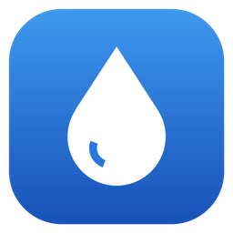
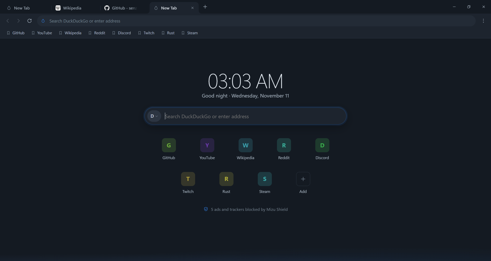
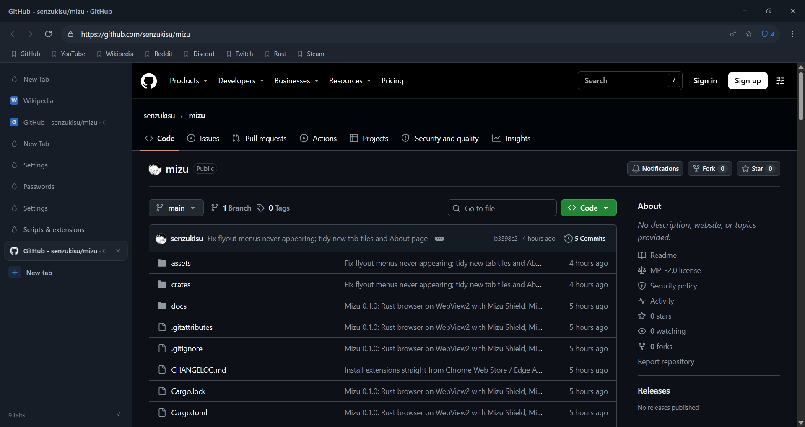
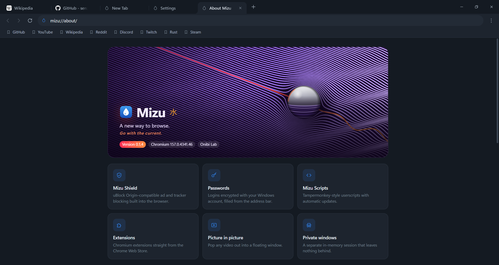
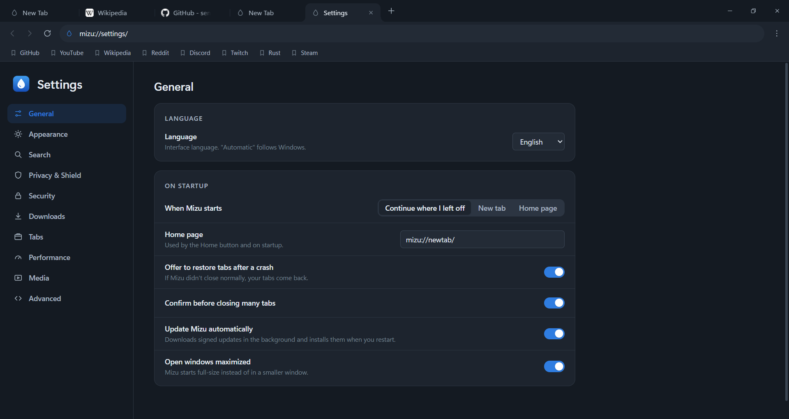

<p align="center">
  
</p>

<h1 align="center">Mizu</h1>
<p align="center"><b>A new way to browse.</b><br>A fast, privacy-focused browser for Windows, written in Rust by <b>Onibi Lab</b>.</p>

<p align="center">
  <a href="https://github.com/senzukisu/mizu/releases/latest"><b>⬇ Download</b></a> ·
  <a href="docs/GUIDE.md">User guide</a> ·
  <a href="CHANGELOG.md">What's new</a> ·
  <a href="ROADMAP.md">Roadmap</a> ·
  <a href="docs/ru/README.md">По-русски</a>
</p>

<p align="center">
  
</p>

*水 (mizu) is Japanese for "water": clear, calm, and quick to take the shape of what you need.*

## Install in a minute

1. Download **`MizuSetup-0.4.2.exe`** from the [latest release](https://github.com/senzukisu/mizu/releases/latest).
2. Run it and press **Install**. No administrator rights are needed.
3. The welcome tour lets you import from your old browser and make Mizu the default — or skip both and do it later in
   Settings → General.

**Needs:** Windows 10 1809+ or Windows 11 (x64) and the
[Microsoft Edge WebView2 Runtime](https://developer.microsoft.com/microsoft-edge/webview2/), already present on
Windows 11 and most Windows 10 PCs. A **portable** zip is on the same page (no auto-updates).
**Uninstall:** Windows Settings → Apps → Installed apps → Mizu; your browsing data stays unless you tick the option.

## Why Mizu

- **Stays fast with many tabs.** Pages are drawn inside Mizu's own window, so a busy page never freezes the interface.
  Background tabs sleep; unload them by hand when you like.
- **Blocks ads and trackers out of the box.** Mizu Shield understands uBlock Origin filter lists — network rules,
  scriptlets, generic and procedural element hiding. One click turns it off for a site.
- **Keeps your data with you.** No telemetry. Passwords are encrypted with your Windows account; private windows leave
  nothing behind; crash reports stay on your PC.
- **Shapes itself to you.** Tabs on top or on the side, tree tabs, groups, spaces, split view; palettes and any accent
  colour; your own shortcuts; userscripts and Chrome extensions.

## What's inside

| | |
|---|---|
| **Tabs** | Top strip or sidebar with pinned sites · tree tabs · groups · spaces · split view · sleeping and unloaded tabs · sessions restored after restarts and crashes |
| **Address bar** | Suggestions from history, bookmarks and open tabs · `@keyword` engines · calculator and unit conversion · `>` quick actions · find on page |
| **Privacy** | Mizu Shield · third-party cookies blocked · per-site settings (cookies, "Keep me signed in", permissions, zoom) · automatic cookie cleanup · Global Privacy Control |
| **Passwords** | Save after sign-in, fill from the address bar, CSV import/export |
| **Music and video** | Media panel for every playing tab · per-site volume · media keys · picture in picture · open in VLC / mpv / PotPlayer / MPC |
| **New tab** | Your own tiles and folders · 13 backgrounds or your picture · clock, now playing, recent tabs, notes |
| **Moving in** | Import from Chrome, Edge, Brave, Vivaldi, Opera or Firefox |
| **Add-ons** | Tampermonkey-style userscripts · Chrome Web Store extensions (Manifest V3) |
| **Engine and updates** | Microsoft Edge WebView2 (current Chromium, H.264/AAC/AV1, hardware decoding) · signed automatic updates that ask first · English and Russian |

<p align="center">
  
</p>
<p align="center">
  
  
</p>

## Good to know

- Windows only for now. Android is planned for 0.4.4, Linux, macOS and iOS for 0.7 ([roadmap](ROADMAP.md)).
- Extensions must be Chromium Manifest V3. They have no toolbar buttons yet, so their pages open in a tab. Firefox
  add-ons are not supported.
- Screen reader support is limited until Mizu provides its own accessibility tree (planned for 0.6).
- Restored tabs keep their address but not their back/forward history.

## Documentation

**Using Mizu**

- [User guide](docs/GUIDE.md) — quick start, "how do I…", every feature, shortcuts, troubleshooting
- [What's new](CHANGELOG.md) · [Roadmap](ROADMAP.md)
- [Security and privacy](docs/SECURITY.md) — what Mizu protects and what it sends
- [Video and codecs](docs/CODECS.md)

**Working on Mizu**

- [Development](docs/DEVELOPMENT.md) — build, run, add features, release
- [Architecture](docs/ARCHITECTURE.md) — how the pieces fit
- [Testing](docs/TESTING.md) — automated tests and the release checklist

All documents are also [in Russian](docs/ru/README.md).

## Build from source

Rust 1.85+ (MSVC) and Visual Studio Build Tools (C++ workload, Windows SDK):

```bash
git clone https://github.com/senzukisu/mizu.git
```

```bash
cd mizu
```

```bash
cargo run --release
```

Details in [DEVELOPMENT](docs/DEVELOPMENT.md).

## Feedback

Found a bug or have an idea? [Open an issue](https://github.com/senzukisu/mizu/issues). Security problems: please
report privately, see [SECURITY](docs/SECURITY.md#reporting-a-vulnerability).

## License

[Mozilla Public License 2.0](LICENSE). Content blocking uses adblock-rust and adblock-resources by Brave Software
(MPL-2.0). Filter lists are downloaded from their maintainers and keep their own licenses. Mizu is not affiliated with
uBlock Origin, Tampermonkey, Microsoft, Google or Brave.

© Onibi Lab
