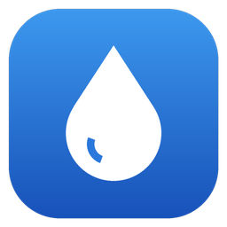
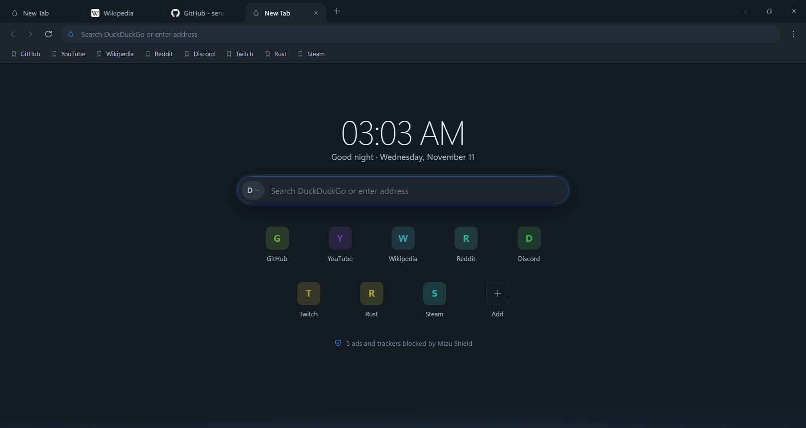
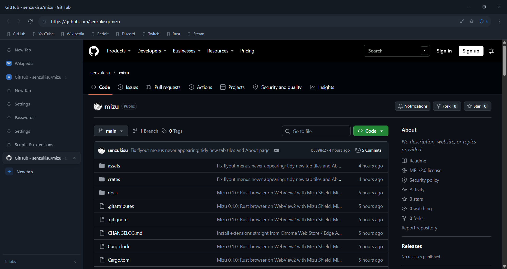
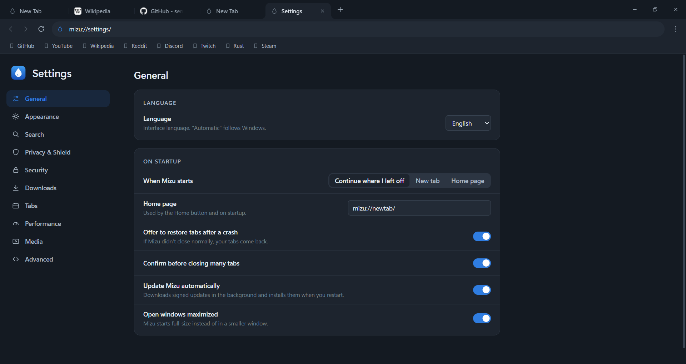
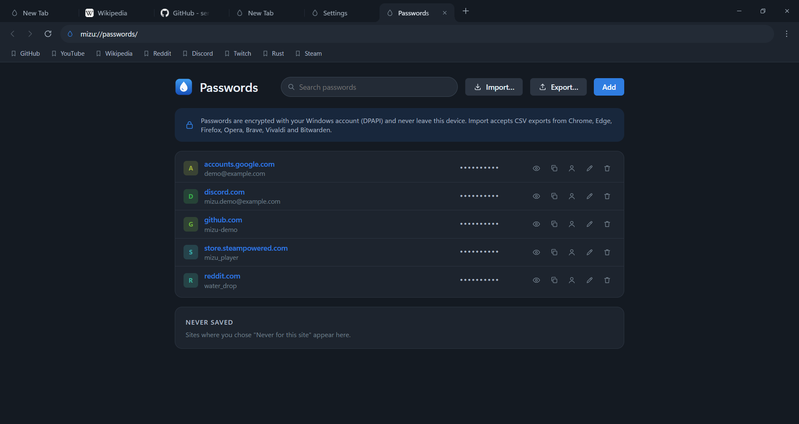

<p align="center">
  
</p>

<h1 align="center">Mizu</h1>
<p align="center"><b>A new way to browse.</b><br>A fast, privacy-focused desktop browser for Windows, written in Rust by <b>Onibi Lab</b>.</p>

<p align="center">
  <a href="https://github.com/senzukisu/mizu/releases/latest"><b>Download</b></a> ·
  <a href="docs/ru/README.md">Документация на русском</a> ·
  <a href="ROADMAP.md">Roadmap</a> ·
  <a href="CHANGELOG.md">Changelog</a>
</p>

<p align="center">
  
</p>

*水 (mizu) means "water" in Japanese: clear, calm, and quick to take the shape of what you need.*

> **0.1.0 is the first release.** Mizu is ready for everyday browsing, but it is young: please
> [report problems](https://github.com/senzukisu/mizu/issues).

## Features

### Browsing
- **A modern Chromium engine.** Mizu uses Microsoft Edge WebView2, which ships with Windows and is updated by it. Current HTML, CSS, JavaScript, WebAssembly, WebGL/WebGPU, WebRTC and HTTP/3 work, with hardware video decoding, H.264/AAC and AV1.
- **Tabs your way.** A classic tab strip, or **vertical tabs** in a sidebar you can resize and collapse. Drag to reorder, pin, duplicate, mute, and reopen closed tabs (Ctrl+Shift+T).
- **Sessions.** Your tabs come back after a restart or a crash. Restored tabs load only when you open them, and new tabs open instantly from a pre-warmed view.
- **New tab page.** Your bookmarks appear as shortcuts, and the "+" tile adds one. You can switch search engines right from the search box.
- **Picture in picture.** Hover any video for a "PiP" button, or press Alt+Shift+P. It works even on sites that hide their own button, and the floating window has previous/next video buttons.
- **Search suggestions** from your search engine while you type (optional, never in private windows).
- **Downloads.** Speed, time left, pause and resume, retry, open, and "show in folder".

### Privacy & security
- **Mizu Shield** blocks ads and trackers with uBlock Origin-compatible filtering, built on [adblock-rust](https://github.com/brave/adblock-rust):
  - network rules, `$redirect`, `$removeparam`, element hiding and `##+js()` scriptlets;
  - about 150,000 rules from uBlock filters, EasyList, EasyPrivacy, Peter Lowe's list and badware lists, plus your own lists and rules;
  - a per-site switch, the engine's tracking prevention (Basic, Balanced or Strict), and Global Privacy Control.
- **Mizu Passwords** saves your logins encrypted with your Windows account (DPAPI):
  - it offers to save a login after you sign in, and fills it from the key icon in the address bar;
  - it imports and exports CSV files from Chrome, Edge, Firefox, Opera, Brave, Vivaldi and Bitwarden.
- **Private windows** use a separate in-memory profile. Nothing is written to history, and everything is discarded when the last private window closes.
- **Site permissions.** Mizu asks before a site uses the camera, microphone, location, notifications or clipboard, and remembers your answer only if you choose.
- **No telemetry.** Mizu sends nothing to Onibi Lab.

### Customisation
- **Mizu Scripts** is a userscript manager compatible with the Tampermonkey/Greasemonkey format:
  - it installs scripts from Greasy Fork, OpenUserJS, GitHub, GitLab, Gist and Codeberg, and can take several links or files at once;
  - scripts update automatically and can use the common `GM_*` API;
  - you decide where each script runs: only on the sites you pick, or never on some sites.
- **Extensions** install with "Add to Mizu" on any Chrome Web Store page, or from a `.crx` or `.zip` file.
- **Themes:**
  - light, dark or system, with five palettes (Mizu, Washi, Matcha, Sumi, Sakura) and any accent colour;
  - a density setting, a soft or crisp style, and Mica translucency;
  - motion that respects "reduce motion".
- **Keyboard shortcuts** you can change in Settings → Shortcuts.
- **Languages:** English and Russian, chosen automatically from Windows.

### Always up to date
- **Signed automatic updates.** Mizu checks GitHub for a new version. Before offering "Restart to update", it verifies the ed25519 signature and the SHA-256 of the installer.
- **The web engine** is kept current by Windows.

<p align="center">
  
</p>
<p align="center">
  
  
</p>

## Install

1. Download **`MizuSetup-0.1.0.exe`** from the [latest release](https://github.com/senzukisu/mizu/releases/latest) and run it.
2. Choose the folder, or keep the default, and press **Install**.
   Mizu installs for your Windows account only, so you don't need administrator rights.
3. Optionally, choose **"Make Mizu the default browser"** at the end of setup.

There is also a **portable** zip. It runs from any folder but does not update itself.

**Requirements:**
- Windows 10 (1809 or later) or Windows 11, x64.
- The [Microsoft Edge WebView2 Runtime](https://developer.microsoft.com/microsoft-edge/webview2/). It is preinstalled on Windows 11 and on most Windows 10 PCs, and Mizu tells you if it is missing.

To uninstall, open Windows Settings → Apps → Installed apps → Mizu. You can choose whether to keep your browsing data.

## Build from source

You need Rust 1.85 or newer (MSVC toolchain) and the Visual Studio Build Tools (C++ workload and Windows SDK).

```bash
git clone https://github.com/senzukisu/mizu.git
```

```bash
cd mizu
```

```bash
cargo run --release
```

Run the tests:

```bash
cargo test --workspace
```

`scripts/release.ps1` builds the installer and the portable zip. See [docs/DEVELOPMENT.md](docs/DEVELOPMENT.md).

### Command line

| Argument | Effect |
|---|---|
| `mizu <url>…` | Open URLs (in the running instance if Mizu is already open) |
| `--private` | Open a private window |
| `--profile <name>` | Use a separate profile |
| `MIZU_USER_DATA=<dir>` | Keep all data in `<dir>` (portable or test setups) |
| `MIZU_LOG=debug` | Write verbose logs to `…\User Data\logs` |

## Documentation

| | English | Русский |
|---|---|---|
| Architecture | [ARCHITECTURE](docs/ARCHITECTURE.md) | [Архитектура](docs/ru/ARCHITECTURE.md) |
| Security | [SECURITY](docs/SECURITY.md) | [Безопасность](docs/ru/SECURITY.md) |
| Codecs | [CODECS](docs/CODECS.md) | [Кодеки](docs/ru/CODECS.md) |
| Development | [DEVELOPMENT](docs/DEVELOPMENT.md) | [Разработка](docs/ru/DEVELOPMENT.md) |
| Testing | [TESTING](docs/TESTING.md) | [Тестирование](docs/ru/TESTING.md) |
| Roadmap | [ROADMAP](ROADMAP.md) | [План развития](docs/ru/ROADMAP.md) |
| Changelog | [CHANGELOG](CHANGELOG.md) | [Изменения](docs/ru/CHANGELOG.md) |

## License

Mizu is licensed under the [Mozilla Public License 2.0](LICENSE).
- Content blocking uses adblock-rust and adblock-resources by Brave Software (MPL-2.0).
- Filter lists are downloaded at runtime from their maintainers and keep their own licenses.
- Mizu is not affiliated with uBlock Origin, Tampermonkey, Microsoft, Google or Brave.

© Onibi Lab
