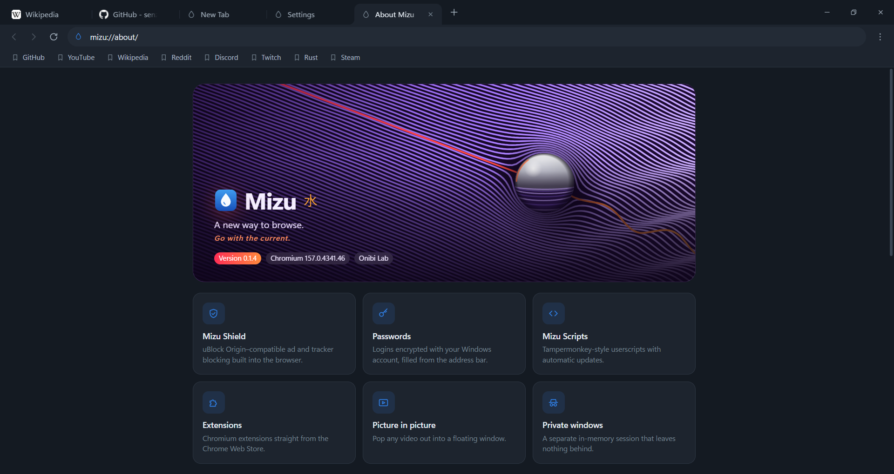

<p align="center">
  
</p>

<h1 align="center">Mizu</h1>
<p align="center"><b>A new way to browse.</b><br>A fast, privacy-focused browser for Windows, written in Rust by <b>Onibi Lab</b>.</p>

<p align="center">
  <a href="https://github.com/senzukisu/mizu/releases/latest"><b>Download</b></a> ·
  <a href="docs/GUIDE.md">User guide</a> ·
  <a href="docs/ru/README.md">По-русски</a> ·
  <a href="CHANGELOG.md">Changelog</a>
</p>

<p align="center">
  
</p>

*水 (mizu) is Japanese for "water": clear, calm, and quick to take the shape of what you need.*

## Why Mizu

- **Fast with many tabs.** Pages are drawn inside Mizu's own window (WebView2 visual hosting), so a busy engine never
  freezes the interface. Background tabs sleep, and you can unload them by hand.
- **Ad and tracker blocking built in.** Mizu Shield is compatible with uBlock Origin filter lists and ships with
  about 150,000 rules. Turn it off per site with one click.
- **Your data stays with you.** There's no telemetry. Passwords are encrypted with your Windows account, and private
  windows leave nothing behind.
- **Made to be shaped.**
  - Vertical or classic tabs;
  - five palettes and any accent colour;
  - your own keyboard shortcuts;
  - userscripts with per-site rules, and Chrome extensions.

## Features

| | |
|---|---|
| **Engine** | Microsoft Edge WebView2 (current Chromium), updated by Windows; hardware video decoding, H.264/AAC, AV1 |
| **Tabs** | Top strip or a resizable, collapsible sidebar; pin, mute, duplicate, unload; reopen closed tabs; sessions restored after restarts and crashes |
| **Address bar** | Searches and addresses; suggestions from history, bookmarks and (optionally) your search engine; `@keyword` engines |
| **Mizu Shield** | uBlock Origin / EasyList syntax: network rules, `$redirect`, `$removeparam`, element hiding, scriptlets; tracking prevention; Global Privacy Control |
| **Passwords** | Save-after-sign-in prompt, fill from the address bar, CSV import/export (Chrome, Edge, Firefox, Opera, Brave, Vivaldi, Bitwarden) |
| **Mizu Scripts** | Tampermonkey-style userscripts from Greasy Fork, GitHub, GitLab and more; automatic updates; run only on the sites you choose |
| **Extensions** | "Add to Mizu" on the Chrome Web Store, or install from `.crx` / `.zip` |
| **Video** | Picture in picture on any video, with previous/next and 10-second skip buttons |
| **Look & feel** | Light, dark or system theme; Mica; density and style; English and Russian |
| **Updates** | Signed (ed25519) automatic updates. Mizu asks before installing them |

<p align="center">
  
</p>
<p align="center">
  
  
</p>

## Install

1. Download **`MizuSetup-0.1.4.exe`** from the [latest release](https://github.com/senzukisu/mizu/releases/latest).
2. Run it, choose a folder (or keep the default) and press **Install**. No administrator rights are needed.

A **portable** zip is also available. It runs from any folder but doesn't update itself.

**Requirements:** Windows 10 1809+ or Windows 11 (x64), and the
[Microsoft Edge WebView2 Runtime](https://developer.microsoft.com/microsoft-edge/webview2/). The runtime is already
present on Windows 11 and most Windows 10 PCs.

**Uninstall:** Windows Settings → Apps → Installed apps → Mizu. Your browsing data is kept unless you choose to
delete it.

## Known limitations

- Windows only for now. Linux, macOS and mobile are planned (see the [roadmap](ROADMAP.md)).
- Extensions must be Chromium Manifest V3 extensions. They have no toolbar buttons, so their pages open in a tab.
  Firefox add-ons are not supported.
- Screen reader support is limited until Mizu provides its own accessibility tree for visually hosted pages.
- Restored tabs keep their address but not their back/forward history.

## Build from source

You need Rust 1.85+ (MSVC) and Visual Studio Build Tools with the C++ workload and Windows SDK.

```bash
git clone https://github.com/senzukisu/mizu.git
```

```bash
cd mizu
```

```bash
cargo run --release
```

Tests, the installer and releases are covered in [DEVELOPMENT](docs/DEVELOPMENT.md) and [TESTING](docs/TESTING.md).

## Documentation

| | English | Русский |
|---|---|---|
| User guide | [GUIDE](docs/GUIDE.md) | [Руководство](docs/ru/GUIDE.md) |
| Architecture | [ARCHITECTURE](docs/ARCHITECTURE.md) | [Архитектура](docs/ru/ARCHITECTURE.md) |
| Security & privacy | [SECURITY](docs/SECURITY.md) | [Безопасность](docs/ru/SECURITY.md) |
| Video & codecs | [CODECS](docs/CODECS.md) | [Кодеки](docs/ru/CODECS.md) |
| Development | [DEVELOPMENT](docs/DEVELOPMENT.md) | [Разработка](docs/ru/DEVELOPMENT.md) |
| Testing | [TESTING](docs/TESTING.md) | [Тестирование](docs/ru/TESTING.md) |
| Roadmap | [ROADMAP](ROADMAP.md) | [План развития](docs/ru/ROADMAP.md) |
| Changelog | [CHANGELOG](CHANGELOG.md) | [Изменения](docs/ru/CHANGELOG.md) |

Found a bug? [Open an issue](https://github.com/senzukisu/mizu/issues). Security problems: see
[SECURITY](docs/SECURITY.md).

## License

[Mozilla Public License 2.0](LICENSE). Content blocking uses adblock-rust and adblock-resources by Brave Software
(MPL-2.0). Filter lists are downloaded from their maintainers and keep their own licenses. Mizu is not affiliated with
uBlock Origin, Tampermonkey, Microsoft, Google or Brave.

© Onibi Lab
