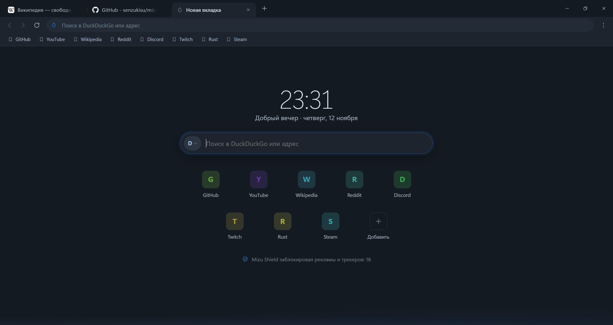
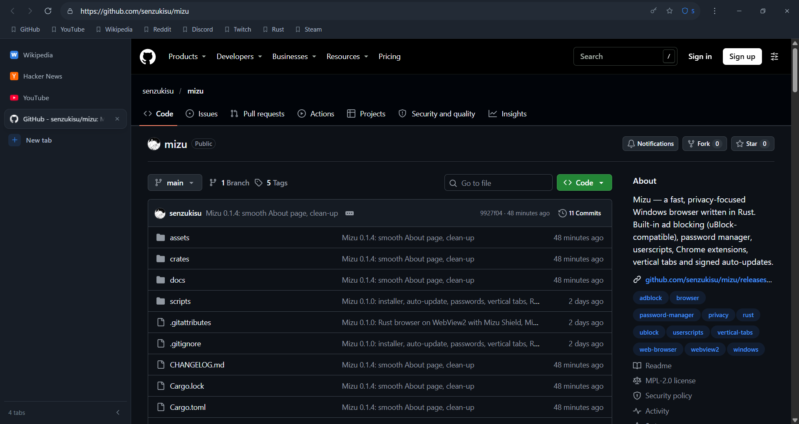

<p align="center">
  
</p>

<h1 align="center">Mizu</h1>
<p align="center"><b>Новый взгляд на браузер.</b><br>Быстрый браузер для Windows с заботой о приватности. Написан на Rust командой <b>Onibi Lab</b>.</p>

<p align="center">
  <a href="https://github.com/senzukisu/mizu/releases/latest"><b>Скачать</b></a> ·
  <a href="GUIDE.md">Руководство</a> ·
  <a href="../../README.md">English</a> ·
  <a href="CHANGELOG.md">Изменения</a>
</p>

<p align="center">
  
</p>

*水 (мидзу) по-японски значит «вода»: чистая, спокойная и легко принимающая нужную форму.*

## Почему Mizu

- **Быстрый даже с множеством вкладок.** Страницы рисуются внутри собственного окна Mizu (визуальное встраивание
  WebView2), поэтому занятый движок не подвешивает интерфейс. Фоновые вкладки засыпают, а лишние можно выгрузить вручную.
- **Встроенная блокировка рекламы и трекеров.** Mizu Shield совместим со списками uBlock Origin, из коробки — около
  150 000 правил. Для отдельного сайта отключается одним щелчком.
- **Ваши данные остаются у вас.** Телеметрии нет. Пароли зашифрованы учётной записью Windows, а приватные окна
  ничего не оставляют после себя.
- **Настраивается под вас.**
  - Вертикальные или обычные вкладки;
  - пять палитр и любой акцентный цвет;
  - свои сочетания клавиш;
  - скрипты с правилами для сайтов и расширения Chrome.

## Возможности

| | |
|---|---|
| **Движок** | Microsoft Edge WebView2 (актуальный Chromium), обновляется Windows; аппаратное декодирование, H.264/AAC, AV1 |
| **Вкладки** | Сверху или в боковой панели (меняет ширину, сворачивается); закрепить, без звука, дублировать, выгрузить; вернуть закрытые; сеанс восстанавливается после перезапуска и сбоя |
| **Адресная строка** | Адреса и поиск; подсказки из истории, закладок и (по желанию) поисковой системы; поисковики по `@ключу` |
| **Mizu Shield** | Синтаксис uBlock Origin / EasyList: сетевые правила, `$redirect`, `$removeparam`, скрытие элементов, скриптлеты; защита от отслеживания; Global Privacy Control |
| **Пароли** | Предложение сохранить после входа, заполнение из адресной строки, импорт и экспорт CSV (Chrome, Edge, Firefox, Opera, Brave, Vivaldi, Bitwarden) |
| **Mizu Scripts** | Скрипты в стиле Tampermonkey с Greasy Fork, GitHub, GitLab и других площадок; автообновление; запуск только на выбранных сайтах |
| **Расширения** | «Добавить в Mizu» в Chrome Web Store или установка из `.crx` / `.zip` |
| **Видео** | «Картинка в картинке» на любом видео, с кнопками «предыдущее/следующее» и перемоткой на 10 секунд |
| **Внешний вид** | Светлая, тёмная или системная тема; Mica; плотность и стиль; русский и английский |
| **Обновления** | Подписанные (ed25519) автообновления. Mizu спрашивает перед установкой |

<p align="center">
  
</p>

## Установка

1. Скачайте **`MizuSetup-0.1.4.exe`** из [последнего выпуска](https://github.com/senzukisu/mizu/releases/latest).
2. Запустите, выберите папку (или оставьте предложенную) и нажмите **«Установить»**. Права администратора не нужны.

Есть и **портативный** zip-архив: он работает из любой папки, но не обновляется сам.

**Требования:** Windows 10 1809+ или Windows 11 (x64) и
[Microsoft Edge WebView2 Runtime](https://developer.microsoft.com/microsoft-edge/webview2/). Среда WebView2 уже есть
в Windows 11 и на большинстве ПК с Windows 10.

**Удаление:** «Параметры Windows» → «Приложения» → «Установленные приложения» → Mizu. Данные браузера сохраняются,
если вы не решите их удалить.

## Известные ограничения

- Пока только Windows. Linux, macOS и мобильные версии запланированы (см. [план развития](ROADMAP.md)).
- Поддерживаются расширения Chromium Manifest V3. У них нет кнопок на панели, их страницы открываются во вкладке.
  Дополнения Firefox не поддерживаются.
- Поддержка экранных дикторов ограничена, пока у Mizu нет собственного дерева доступности для визуально встроенных
  страниц.
- Восстановленные вкладки помнят адрес, но не историю «назад/вперёд».

## Сборка из исходников

Нужен Rust 1.85+ (MSVC) и Visual Studio Build Tools с компонентом C++ и Windows SDK.

```bash
git clone https://github.com/senzukisu/mizu.git
```

```bash
cd mizu
```

```bash
cargo run --release
```

Тесты, установщик и выпуск версий описаны в разделах [Разработка](DEVELOPMENT.md) и [Тестирование](TESTING.md).

## Документация

- [Руководство пользователя](GUIDE.md)
- [Архитектура](ARCHITECTURE.md)
- [Безопасность и приватность](SECURITY.md)
- [Видео и кодеки](CODECS.md)
- [Разработка](DEVELOPMENT.md)
- [Тестирование](TESTING.md)
- [План развития](ROADMAP.md)
- [Изменения](CHANGELOG.md)

Нашли ошибку? [Сообщите о ней](https://github.com/senzukisu/mizu/issues). О проблемах безопасности — см.
[Безопасность](SECURITY.md).

## Лицензия

[Mozilla Public License 2.0](../../LICENSE). Блокировка контента использует adblock-rust и adblock-resources от Brave
Software (MPL-2.0). Списки фильтров загружаются у их авторов и распространяются по своим лицензиям. Mizu не связан с
uBlock Origin, Tampermonkey, Microsoft, Google и Brave.

© Onibi Lab
