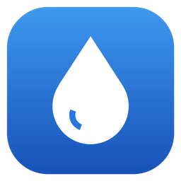
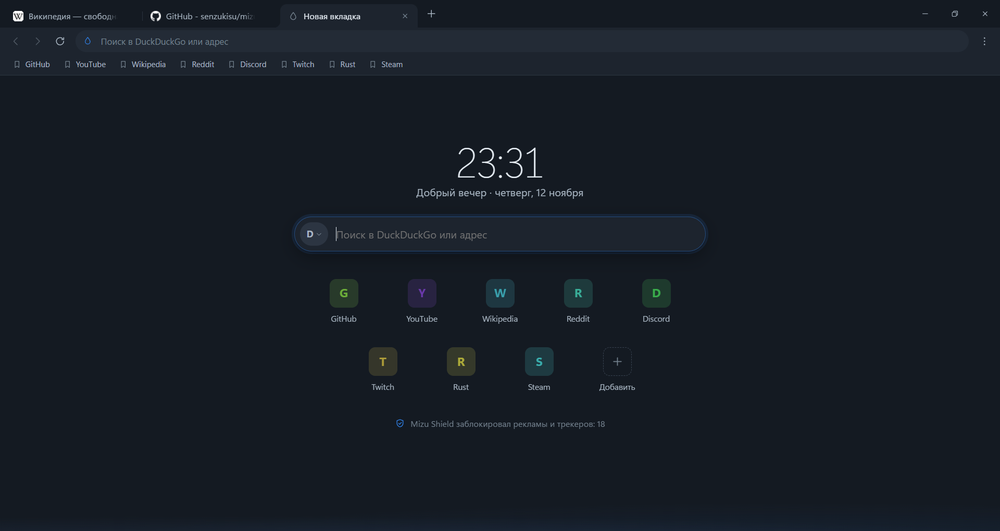
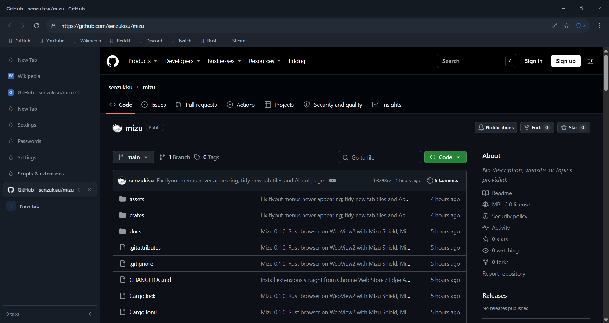

<p align="center">
  
</p>

<h1 align="center">Mizu</h1>
<p align="center"><b>Новый взгляд на браузер.</b><br>Быстрый браузер для Windows с заботой о приватности. Написан на Rust командой <b>Onibi Lab</b>.</p>

<p align="center">
  <a href="https://github.com/senzukisu/mizu/releases/latest"><b>⬇ Скачать</b></a> ·
  <a href="GUIDE.md">Руководство</a> ·
  <a href="CHANGELOG.md">Что нового</a> ·
  <a href="ROADMAP.md">План развития</a> ·
  <a href="../../README.md">English</a>
</p>

<p align="center">
  
</p>

*水 (мидзу) по-японски значит «вода»: чистая, спокойная и легко принимающая нужную форму.*

## Установка за минуту

1. Скачайте **`MizuSetup-0.4.0.exe`** из [последнего выпуска](https://github.com/senzukisu/mizu/releases/latest).
2. Запустите и нажмите **«Установить»**. Права администратора не нужны.
3. Приветственный тур предложит перенести данные из старого браузера и сделать Mizu браузером по умолчанию — или
   пропустите оба шага и сделайте это позже в «Настройки» → «Основные».

**Нужно:** Windows 10 1809+ или Windows 11 (x64) и
[Microsoft Edge WebView2 Runtime](https://developer.microsoft.com/microsoft-edge/webview2/) — он уже есть в Windows 11
и на большинстве ПК с Windows 10. На той же странице есть **портативный** zip (без автообновлений).
**Удаление:** «Параметры Windows» → «Приложения» → «Установленные приложения» → Mizu; данные браузера остаются, если не
отметить их удаление.

## Почему Mizu

- **Быстр и со множеством вкладок.** Страницы рисуются внутри окна Mizu, поэтому тяжёлая страница не подвешивает
  интерфейс. Фоновые вкладки засыпают, а выгрузить их можно и вручную.
- **Блокирует рекламу и трекеры сразу.** Mizu Shield понимает списки фильтров uBlock Origin — сетевые правила,
  скриптлеты, общее и процедурное скрытие элементов. Выключается для сайта одним щелчком.
- **Ваши данные остаются у вас.** Никакой телеметрии. Пароли зашифрованы учётной записью Windows, приватные окна не
  оставляют следов, отчёты о сбоях не покидают ПК.
- **Подстраивается под вас.** Вкладки сверху или сбоку, дерево вкладок, группы, пространства, разделённый экран;
  палитры и любой акцентный цвет; свои сочетания клавиш; пользовательские скрипты и расширения Chrome.

## Что внутри

| | |
|---|---|
| **Вкладки** | Полоса сверху или боковая панель с закреплёнными сайтами · дерево вкладок · группы · пространства · разделённый экран · спящие и выгруженные вкладки · восстановление сеанса после перезапуска и сбоя |
| **Адресная строка** | Подсказки из истории, закладок и открытых вкладок · поисковики по `@ключу` · калькулятор и пересчёт единиц · быстрые действия `>` · поиск на странице |
| **Приватность** | Mizu Shield · сторонние куки заблокированы · настройки сайта (куки, «Не выходить из аккаунта», разрешения, масштаб) · автоочистка куки · Global Privacy Control |
| **Пароли** | Сохранение после входа, заполнение из адресной строки, импорт и экспорт CSV |
| **Музыка и видео** | Панель медиа для всех играющих вкладок · громкость для сайта · медиаклавиши · картинка в картинке · открыть в VLC / mpv / PotPlayer / MPC |
| **Новая вкладка** | Свои плитки и папки · 13 фонов или своя картинка · часы, «Сейчас играет», недавние вкладки, заметки |
| **Переезд** | Импорт из Chrome, Edge, Brave, Vivaldi, Opera или Firefox |
| **Дополнения** | Скрипты в стиле Tampermonkey · расширения из Chrome Web Store (Manifest V3) |
| **Движок и обновления** | Microsoft Edge WebView2 (актуальный Chromium, H.264/AAC/AV1, аппаратное декодирование) · подписанные автообновления, которые сначала спрашивают · русский и английский |

<p align="center">
  
</p>

## Полезно знать

- Пока только Windows; Linux, macOS и мобильные в планах ([план развития](ROADMAP.md)).
- Расширения — только Chromium Manifest V3. Кнопок на панели у них пока нет, их страницы открываются во вкладке.
  Дополнения Firefox не поддерживаются.
- Поддержка экранных дикторов ограничена, пока у Mizu нет собственного дерева доступности (запланировано на 0.6).
- Восстановленные вкладки помнят адрес, но не историю «назад/вперёд».

## Документация

**Пользователям**

- [Руководство](GUIDE.md) — быстрый старт, «как сделать…», все возможности, сочетания клавиш, решение проблем
- [Что нового](CHANGELOG.md) · [План развития](ROADMAP.md)
- [Безопасность и приватность](SECURITY.md) — что защищает Mizu и что он отправляет
- [Видео и кодеки](CODECS.md)

**Разработчикам**

- [Разработка](DEVELOPMENT.md) — сборка, запуск, добавление возможностей, выпуск
- [Архитектура](ARCHITECTURE.md) — как всё устроено
- [Тестирование](TESTING.md) — автотесты и проверка перед выпуском

Все документы есть и [на английском](../../README.md).

## Сборка из исходников

Rust 1.85+ (MSVC) и Visual Studio Build Tools (рабочая нагрузка C++, Windows SDK):

```bash
git clone https://github.com/senzukisu/mizu.git
```

```bash
cd mizu
```

```bash
cargo run --release
```

Подробности — в [Разработке](DEVELOPMENT.md).

## Обратная связь

Нашли ошибку или есть идея? [Создайте issue](https://github.com/senzukisu/mizu/issues). Уязвимости — пожалуйста,
сообщайте приватно, см. [Безопасность](SECURITY.md#как-сообщить-об-уязвимости).

## Лицензия

[Mozilla Public License 2.0](../../LICENSE). Блокировка контента использует adblock-rust и adblock-resources от Brave
Software (MPL-2.0). Списки фильтров скачиваются у их авторов и распространяются по своим лицензиям. Mizu не связан с
uBlock Origin, Tampermonkey, Microsoft, Google или Brave.

© Onibi Lab
